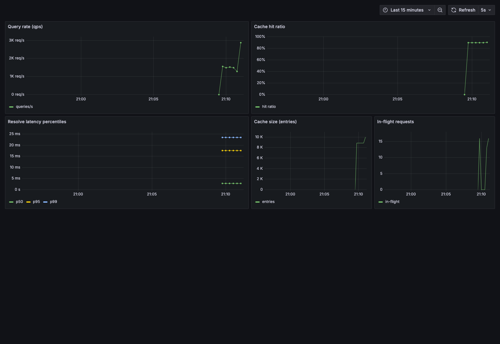

# Adaptive DNS Resolver with Self-Optimizing Cache

A concurrent DNS resolver in Go with a TTL-aware LRU cache, Prometheus metrics,
and (later) an ML-driven adaptive eviction layer.

## Status
Stages 1–8a complete: concurrent UDP resolver, hand-rolled TTL-aware LRU cache
(race-detector clean under concurrent load), bounded worker pool, in-process
Prometheus metrics, a reproducible cache-on vs cache-off benchmark, a one-command
Dockerized Prometheus + Grafana stack, a telemetry pipeline that logs engineered
features per query, an XGBoost retention model served in-process in Go for
sampled adaptive eviction + admission (deterministic LRU fallback), and a
three-way benchmark showing where the model beats LRU.

Key measured results:
- Caching vs none: **~9.8× throughput, ~53× lower median latency** at a 90% hit
  ratio (controlled 20 ms upstream).
- Adaptive vs LRU on a recency-hostile workload: LRU **0% hits**, adaptive
  **~44%**, **~1.76× throughput, ~2× lower median latency**. On recency-friendly
  traffic the model ties LRU — stated honestly.

See [BENCHMARKS.md](BENCHMARKS.md) for both benchmarks and their limits,
[TELEMETRY.md](TELEMETRY.md) for the feature/label pipeline, and
[MODEL.md](MODEL.md) for training, Go inference parity, and the eviction/admission
policy.

Still to build (Stage 8b): predictive prefetching (the 4th config), and an
LFU baseline to isolate the model's value over plain frequency.

## Observability stack

`docker compose up --build` brings up four services, all preconfigured:

| Service | Purpose | URL |
|---|---|---|
| `stubupstream` | controlled upstream (fixed 20 ms RTT) | internal |
| `resolver` | the DNS resolver (scratch image, ~14 MB) | udp://localhost:8053 |
| `prometheus` | scrapes `resolver:9153/metrics` every 2 s | http://localhost:9090 |
| `grafana` | preprovisioned dashboard + datasource | http://localhost:3000 |

Drive traffic from the host to see the dashboard move:

```sh
go build -o bin/loadtest ./cmd/loadtest
./bin/loadtest -addr 127.0.0.1:8053 -duration 60s -concurrency 50 -hot 20 -phot 0.9
```



The resolver image is `FROM scratch` with a static binary, so it has no shell;
the container health check re-execs the binary in `-health-check` mode to probe
its own `/metrics` endpoint. Prometheus and Grafana configs are baked into their
images (no host bind-mounts), so the stack is fully self-contained.

## Benchmark

```sh
go build -o bin/stubupstream ./cmd/stubupstream   # controlled upstream
go build -o bin/resolver     ./cmd/resolver        # the resolver
go build -o bin/loadtest      ./cmd/loadtest        # concurrent query client
```

Full reproduction steps are in [BENCHMARKS.md](BENCHMARKS.md).
